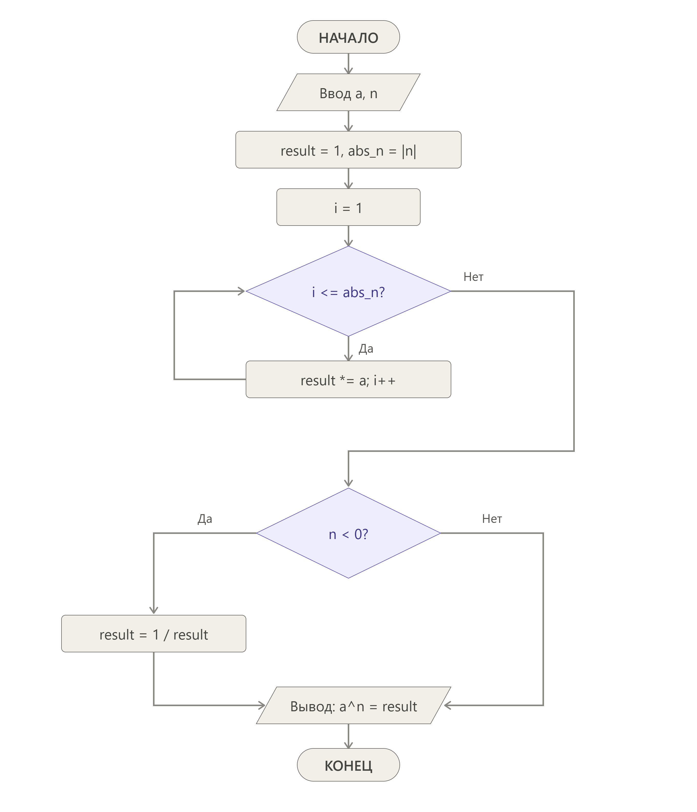

# Домашнее задание к работе 8

## Условие задачи
**Вычислить с использованием цикла for значение произведения (1 + sin(0.1)) · (1 + sin(0.2)) · ... · (1 + sin(10)).**

---

## 1. Алгоритм и блок-схема

### Алгоритм

1. **Начало**
2. **Инициализация:**
   - Установить `result = 1` (начальное значение произведения)
3. **Цикл for (i от 1 до 100):**
   - Аргумент синуса равен `0.1 * i` (от 0.1 до 10 с шагом 0.1)
   - На каждой итерации умножать результат на очередной множитель: `result *= 1 + sin(0.1 * i)`
4. **Вывод результата:**
   - Вывести значение `result`
5. **Конец**

### Блок-схема


## 2. Реализация программы

```c
int TaskDZ() {
    double result = 1;

    for (int i = 1; i <= 100; i++) {
        result *= 1 + sin(0.1 * i);
    }

    printf("Результат: %e\n", result);

    return 0;
}
```

## 3. Результаты работы программы
Результат: 1.729841e-14

## 4. Информация о разработчике
Сайкин Михаил Сергеевич, бТИИ-261
